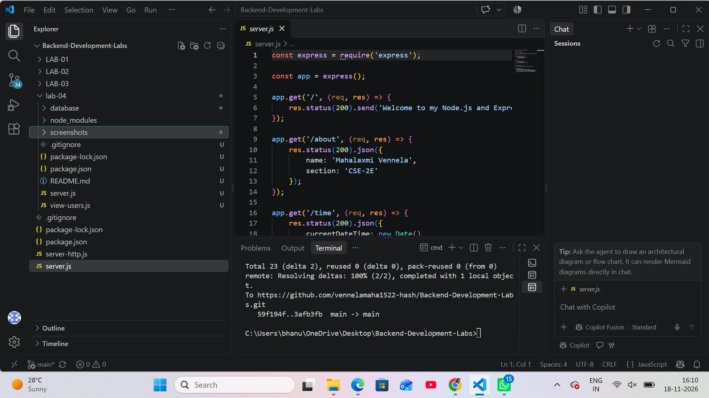

# Lab 04 – User Registration, Login and JWT Authentication

A backend authentication application developed using Node.js, Express.js, SQLite, bcrypt, and JSON Web Tokens (JWT). This project allows users to register an account, securely store passwords using hashing, log in with their credentials, and receive a JWT token for authentication.

---

## Project Identity

| Attribute | Details |
|---|---|
| Lab Number | Lab 04 |
| Lab Title | Registration, Login and JWT Authentication |
| Student Name | Mahalaxmi Vennela |
| Registration Number | 252U1R1257 |
| Section | CSE-2E |
| Course | Backend Development Fundamentals |
| Programme | B.Tech – Computer Science and Engineering |
| Academic Level | Year II – Term II |
| Project Type | Backend Development / Authentication API |
| Institution | AURORA DEEMED UNIVERSITY |
| Faculty / Instructor | Yugendhar |
| Academic Year | 2026 |
| Submission Date | 18-11-2026 |

## Project Links

| Platform | Link |
|---|---|
| GitHub Repository | https://github.com/vennelamaha1522-hash/Backend-Development-Labs |
| Lab Folder | `lab-04` |
| Local API Base URL | http://localhost:3000 |
| Server Check | GET http://localhost:3000/ |

---

## Table of Contents

1. Project Overview
2. Project Objectives
3. Technology Stack
4. Project Structure
5. System Architecture
6. Database Documentation
7. Authentication Concepts
8. Complete REST API Documentation
9. Password Hashing Using bcrypt
10. JWT Token Generation and Validation
11. Validation and Error Handling
12. Installation and Execution
13. Testing Using Postman
14. Screenshots
15. Security Considerations
16. Problems and Solutions
17. Learning Outcomes
18. Project Scope and Limitations
19. Conclusion

---

# 1. Project Overview

## Background

Authentication is an important part of backend application development. Websites and applications need to identify users before allowing them to access account-related information.

Storing passwords directly in a database is not secure. Therefore, password hashing and token-based authentication are used to protect user information.

## Problem Statement

Applications require a secure way to register users and verify their identities during login.

- User registration requires proper validation of input details.
- Passwords should not be stored as plain text.
- Duplicate usernames should be prevented.
- Login credentials must be checked before granting access.
- Authentication information should be provided securely after successful login.

## Proposed Solution

This project implements a user authentication REST API using Node.js and Express.js.

It uses SQLite to store user information, bcrypt to hash passwords, and JSON Web Tokens to generate authentication tokens after successful login.

## Project Objectives

- Create a user registration API.
- Create a user login API.
- Store user information in an SQLite database.
- Hash passwords using bcrypt before saving them.
- Prevent duplicate usernames during registration.
- Verify passwords during login.
- Generate JWT tokens after successful authentication.
- Understand JWT token generation and validation.
- Test API endpoints using Postman.

## Main Functionalities

| Functionality | Description |
|---|---|
| User Registration | Creates a new user account |
| Password Hashing | Converts passwords into secure hashes using bcrypt |
| Duplicate User Validation | Prevents registration with an existing username |
| User Login | Checks username and password |
| Password Verification | Compares the entered password with the stored hash |
| JWT Generation | Generates a token after successful login |
| Token Validation | Verifies the JWT token using the secret key |
| Database Management | Stores user details in SQLite |

---

# 2. Technology Stack

| Technology | Purpose |
|---|---|
| Node.js | Runs the JavaScript backend application |
| Express.js | Handles HTTP requests and API routes |
| SQLite | Stores registered user information |
| sqlite3 | Connects Node.js with the SQLite database |
| bcrypt | Hashes passwords and verifies them |
| jsonwebtoken | Generates and verifies JWT tokens |
| Postman | Tests API requests and responses |
| Visual Studio Code | Used for writing and managing project code |
| Git and GitHub | Used for version control and project submission |

---

# 3. Project Structure

The project is organized into the following folders and files.

```text
lab-04/
│
├── database/
│   ├── db.js
│   ├── init-db.js
│   └── users.db
│
├── screenshots/
│   ├── register-success.png
│   ├── register-duplicate.png
│   ├── register-invalid.png
│   ├── login-success.png
│   ├── login-wrong-password.png
│   ├── login-invalid-user.png
│   ├── login-missing-fields.png
│   ├── database-users.png
│   └── jwt-decoded.png
│
├── server.js
├── view-users.js
├── verify-token.js
├── package.json
├── package-lock.json
├── .gitignore
└── README.md
```

**File and Module Responsibilities**

| File / Directory | Responsibility |
|---|---|
| server.js | Main Express server and registration and login API routes |
| database/db.js | Creates and connects to the SQLite database |
| database/init-db.js | Creates the users table |
| database/users.db | Stores registered user records locally |
| view-users.js | Displays user records for database verification |
| verify-token.js | Demonstrates JWT token verification |
| package.json | Contains project dependencies and npm scripts |
| package-lock.json | Records exact dependency versions |
| screenshots/ | Stores screenshots of API testing and database results |
| .gitignore | Excludes files that should not be committed to GitHub |
| README.md | Documents the project and its implementation |

---

# 4. System Architecture

## Application Workflow

The application follows a simple backend authentication workflow.

```text
             User
               |
               v
       Express.js Server
               |
        +------+------+
        |             |
        v             v
    Register        Login
        |             |
        v             v
   Validate Data  Validate Data
        |             |
        v             v
   Check Username  Find User
        |             |
        v             v
   Hash Password  Compare Password
        |             |
        v             v
   SQLite Database  Generate JWT
        |             |
        v             v
 Registration      JWT Token
  Response        Login Response
```

## Architecture Components

| Component | Responsibility |
|---|---|
| Client | Sends registration and login requests |
| Express Server | Receives and processes API requests |
| Authentication Logic | Validates usernames and passwords |
| bcrypt | Hashes and compares passwords |
| SQLite Database | Stores user records |
| JWT | Creates and verifies authentication tokens |

---

# 5. Database Documentation

## Database Name

`users.db`

## Table Name

`users`

## Table Schema

| Column | Data Type | Constraints |
|---|---|---|
| id | INTEGER | Primary Key, AUTOINCREMENT |
| username | TEXT | UNIQUE, NOT NULL |
| name | TEXT | NOT NULL |
| password | TEXT | NOT NULL |

## Database Design

The users table stores the information required for user authentication.

- `id` uniquely identifies each registered user.
- `username` stores the user's unique login username.
- `name` stores the user's name.
- `password` stores the bcrypt password hash instead of the original password.

## Example Database Record

| id | username | name | password |
|---|---|---|---|
| 1 | maha123 | Mahalaxmi | bcrypt hashed value |

**Note:** The password column contains a hashed value, not the original password.

---

# 6. Authentication Concepts

## What is Authentication?

Authentication is the process of verifying the identity of a user. In this project, authentication is performed by checking the username and password provided during login.

## User Registration

During registration:

1. The user enters a username, name, and password.
2. The server checks whether all required fields are provided.
3. The server checks whether the username already exists.
4. bcrypt hashes the password.
5. The user information is inserted into the SQLite database.
6. A registration success response is returned.

## User Login

During login:

1. The user enters their username and password.
2. The server searches for the username in the database.
3. bcrypt compares the entered password with the stored password hash.
4. If the credentials are correct, a JWT token is generated.
5. The server returns the token in the response.

## Authentication Flow

```text
Registration
     |
     v
Validate User Details
     |
     v
Hash Password
     |
     v
Save User in Database
     |
     v
Registration Successful


Login
     |
     v
Check Username
     |
     v
Compare Password
     |
     v
Generate JWT Token
     |
     v
Return Token
```

---

# 7. Password Hashing Using bcrypt

## What is bcrypt?

bcrypt is a password-hashing library used to protect user passwords. It converts the original password into a hash before storing it in the database.

## Why is Password Hashing Important?

- Protects original passwords from being stored directly.
- Improves database security.
- Makes password verification possible without storing plain-text passwords.
- Helps protect user information if the database is exposed.

## Password Hashing Example

```javascript
const bcrypt = require("bcrypt");

const hashedPassword = await bcrypt.hash(password, 10);
```

Here, `10` represents the salt rounds used by bcrypt.

## Password Verification

```javascript
const isPasswordMatched = await bcrypt.compare(
    password,
    user.password
);
```

The compare function checks whether the entered password matches the stored hash.

---

# 8. JWT Token Generation and Validation

## What is JWT?

JSON Web Token (JWT) is a token format used to securely represent information between a client and a server.

In this project, a JWT token is generated after successful login.

## JWT Structure

A JWT contains three parts:

1. Header – Contains token type and signing algorithm.
2. Payload – Contains information such as the username and token timestamps.
3. Signature – Verifies that the token has not been modified.

```text
Header.Payload.Signature
```

## JWT Token Generation

The jsonwebtoken package is used to generate the token.

```javascript
const jwt = require("jsonwebtoken");

const token = jwt.sign(
    { username: user.username },
    JWT_SECRET,
    { expiresIn: "1h" }
);
```

## JWT Token Validation

The `jwt.verify()` method checks whether a token is valid using the same secret key.

```javascript
const decoded = jwt.verify(token, JWT_SECRET);
```

If the token is valid, the decoded payload is returned. If it is invalid or expired, verification fails.

## Token Expiration

The token is configured to expire after one hour using:

```javascript
{ expiresIn: "1h" }
```

---

# 9. Complete REST API Documentation

## Base URL

```text
http://localhost:3000
```

## Endpoint Summary

| Method | Endpoint | Purpose | Expected Status |
|---|---|---|---|
| GET | / | Check whether the server is running | 200 |
| POST | /register/ | Register a new user | 201, 400 |
| POST | /login/ | Login and generate JWT token | 200, 400 |

## 9.1 Server Check

**GET /**

Checks whether the backend server is running.

Example request:

```http
GET http://localhost:3000/
```

Expected result: The server returns its welcome or running message.

## 9.2 User Registration

**POST /register/**

Registers a new user.

Example request:

```http
POST http://localhost:3000/register/
```

Request body:

```json
{
    "username": "maha123",
    "name": "Mahalaxmi",
    "password": "maha@123"
}
```

Expected result:

- Status: `201 Created`
- User registration successful.
- Password is stored as a bcrypt hash.

## 9.3 Duplicate User Registration

**POST /register/**

Sending the same username again should return a duplicate username error.

Example request:

```json
{
    "username": "maha123",
    "name": "Mahalaxmi",
    "password": "maha@123"
}
```

Expected result:

- Status: `400 Bad Request`
- Duplicate username is rejected.

## 9.4 User Login

**POST /login/**

Checks the user's login credentials and generates a JWT token.

Example request:

```http
POST http://localhost:3000/login/
```

Request body:

```json
{
    "username": "maha123",
    "password": "maha@123"
}
```

Expected result:

- Status: `200 OK`
- Login successful.
- JWT token is returned.

Example response structure:

```json
{
    "jwt_token": "generated_jwt_token"
}
```

The actual token will be generated by the server.

## 9.5 Login With Incorrect Password

Sending an incorrect password should return an error response.

Example request:

```json
{
    "username": "maha123",
    "password": "wrongpassword"
}
```

Expected result:

- Status: `400 Bad Request`
- Login is rejected.

## 9.6 Login With Invalid Username

Sending a username that is not registered should return an error response.

Expected result:

- Status: `400 Bad Request`
- User is not found.

## 9.7 Login With Missing Fields

If the username or password is missing, the server should reject the request.

Expected result:

- Status: `400 Bad Request`
- Required fields validation error.

---

# 10. Validation and Error Handling

The application performs validation before processing user requests.

| Input or Condition | Validation Rule |
|---|---|
| Username | Must be provided |
| Name | Must be provided during registration |
| Password | Must be provided |
| Duplicate username | Registration must be rejected |
| Invalid username | Login must be rejected |
| Incorrect password | Login must be rejected |
| Missing request fields | Return a validation error |
| Database operation | Handle errors without crashing the server |
| JWT verification | Reject invalid or expired tokens |

## HTTP Status Codes

| Status Code | Meaning |
|---|---|
| 200 OK | Request completed successfully |
| 201 Created | New user registered successfully |
| 400 Bad Request | Invalid input or authentication failure |
| 500 Internal Server Error | Server-side error |

---

# 11. Installation and Execution

## 1. Prerequisites

Install the following tools:

- Node.js
- npm
- Visual Studio Code
- Postman

## 2. Open the Project Folder

Open the `lab-04` folder in Visual Studio Code.

Open the terminal inside the project directory.

## 3. Install Dependencies

Run:

```bash
npm install
```

## 4. Initialize the Database

Run:

```bash
node database/init-db.js
```

The database and users table will be created.

## 5. Start the Backend Server

Run:

```bash
npm start
```

Or use:

```bash
node server.js
```

Expected terminal output:

```text
Database connected successfully!
Server running on port 3000
```

The exact messages depend on the implementation.

## 6. Check the Server

Open the browser or Postman and visit:

```text
http://localhost:3000/
```

## 7. Test the API

Use Postman to test registration and login endpoints.

## 8. Stop the Server

Press:

```text
Ctrl + C
```

---

# 12. Testing Using Postman

Postman is used to test the API endpoints and verify their responses.

## Testing Scenarios

| Test No. | Test Case | Expected Result |
|---|---|---|
| 1 | Check server status | Server running message |
| 2 | Register a new user | 201 Created |
| 3 | Register an existing username | 400 Bad Request |
| 4 | Register without required fields | 400 Bad Request |
| 5 | Login with correct credentials | 200 OK with JWT |
| 6 | Login with incorrect password | 400 Bad Request |
| 7 | Login with invalid username | 400 Bad Request |
| 8 | Login without required fields | 400 Bad Request |
| 9 | Verify a valid JWT token | Token verification successful |
| 10 | Verify an invalid or expired token | Verification rejected |

## Postman Request Configuration

For registration and login:

- Method: POST
- URL: Use the required endpoint.
- Select Body.
- Select raw.
- Choose JSON.
- Enter the request data.
- Click Send.
- Check the response status and body.

---

# 13. Screenshots

Screenshots should be added to the `screenshots/` folder to show the working process and test results.

## Screenshot Gallery

| Screenshot | Description |
|---|---|
| register-success.png | Successful user registration |
| register-duplicate.png | Duplicate username validation |
| register-invalid.png | Registration with missing or invalid fields |
| login-success.png | Successful login response |
| login-wrong-password.png | Login with an incorrect password |
| login-invalid-user.png | Login using an unregistered username |
| login-missing-fields.png | Login with missing fields |
| database-users.png | User records stored in SQLite |
| jwt-decoded.png | Decoded JWT header and payload |

**Note:** Add your actual screenshots to the folder and make sure the filenames match the links below.

### Project Structure Screenshot




### Registration Success


### Duplicate Registration


### Login Success


### Incorrect Password


### Database Records


### JWT Token


---

# 14. Security Considerations

The project demonstrates basic security practices for user authentication.

- Passwords are hashed using bcrypt before database insertion.
- Duplicate usernames are prevented.
- Password verification uses bcrypt comparison.
- JWT tokens are signed using a secret key.
- Tokens have an expiration time.
- Secret keys should be stored in environment variables and should not be uploaded to GitHub.
- Database files and private credentials should be excluded from version control.

## Important Files to Exclude From GitHub

```gitignore
node_modules/
.env
*.log
database/*.db
```

---

# 15. Problems and Solutions

| Problem | Solution |
|---|---|
| Node.js command not recognized | Install Node.js and check its PATH configuration |
| Cannot find module | Run commands from the correct project directory and install dependencies |
| Database not found | Run the database initialization file |
| Username already exists | Register using a different username |
| Incorrect password | Enter the correct registered password |
| JWT verification failed | Check the token and secret key |
| Server port already in use | Stop the other process using port 3000 or use an available port |
| GitHub push failed | Check Git configuration and repository connection |

---

# 16. Learning Outcomes

After completing this lab, I learned how to:

1. Build REST APIs using Node.js and Express.js.
2. Implement user registration and login functionality.
3. Connect an Express application with an SQLite database.
4. Hash passwords using bcrypt.
5. Verify passwords using bcrypt comparison.
6. Prevent duplicate usernames during registration.
7. Generate JWT tokens using the jsonwebtoken package.
8. Understand JWT token structure and expiration.
9. Verify JWT tokens using a secret key.
10. Test backend authentication APIs using Postman.
11. Understand the importance of protecting user credentials.
12. Organize and upload backend lab projects to GitHub.

---

# 17. Project Scope and Limitations

## Current Scope

The project implements:

- User registration.
- User login.
- Password hashing.
- Duplicate username validation.
- SQLite database storage.
- JWT token generation.
- JWT token verification.

## Current Limitations

- The project does not include a frontend user interface.
- User information is stored in a local SQLite database.
- The application demonstrates basic authentication functionality.
- A complete role-based authorization system is not included.

## Possible Future Enhancements

- Add protected API routes using JWT authentication middleware.
- Add user profile management.
- Implement role-based access control.
- Add password reset functionality.
- Improve validation and error handling.
- Deploy the backend application online.

---

# 18. Conclusion

This lab helped me understand the implementation of user authentication using Node.js and Express.js. I learned how to create registration and login APIs, store user information in an SQLite database, and protect passwords using bcrypt hashing.

I also learned how JSON Web Tokens are generated after successful login and how tokens can be verified using a secret key. Testing the endpoints through Postman helped me understand API requests, responses, validation, and error handling.

Overall, this lab improved my practical understanding of backend development, database connectivity, password security, and token-based authentication.

---

**Submitted By:** Mahalaxmi Vennela  
**Registration Number:** 252U1R1257  
**Section:** CSE-2E  
**Course:** Backend Development Fundamentals  
**Lab:** 04 – Registration, Login and JWT Authentication